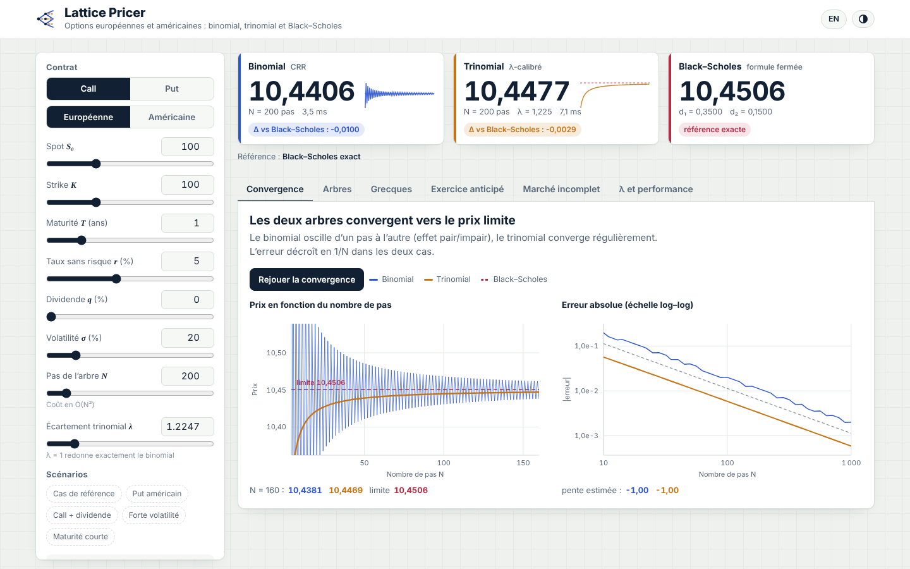

# Lattice Pricer

**Pricing d'options européennes et américaines par arbres binomial et trinomial, et convergence vers Black–Scholes.**

Une application web en un seul fichier (`index.html`), sans dépendance ni serveur. Le moteur de calcul est écrit en JavaScript pur et tourne dans le navigateur : chaque mouvement de curseur recalcule les trois prix, les courbes de convergence et les grecques en quelques millisecondes.



## Ce que fait l'application

| Onglet | Contenu |
|---|---|
| **Tableau des prix** | Les trois prix côte à côte : binomial CRR, trinomial calibré par λ, Black–Scholes. Écart à la référence, temps de calcul et mini-courbe de convergence pour chaque modèle. |
| **Convergence** | Prix en fonction de N (oscillation pair/impair du binomial, convergence régulière du trinomial) et erreur en échelle log–log, avec la pente estimée (≈ −1, soit une erreur en O(1/N)). Animation rejouable. |
| **Arbres** | Les deux arbres affichés nœud par nœud, avec animation de la récurrence rétrograde. Survol d'un nœud : sous-jacent, valeur, continuation, exercice immédiat, delta de couverture. Nœuds d'exercice anticipé mis en évidence. |
| **Grecques** | Δ, Γ, Θ lus sur l'arbre ; vega et ρ par différences finies, comparés aux formules fermées de Black–Scholes. Profil du prix en fonction du spot. |
| **Exercice anticipé** | Frontière d'exercice optimal S*(t) estimée par les deux arbres, prime d'exercice anticipé. |
| **Marché incomplet** | Exemple à une période et trois états : famille de probabilités risque-neutres à un paramètre et intervalle des prix sans arbitrage. |
| **λ et performance** | Erreur moyenne selon λ, et erreur selon le temps de calcul (comparaison binomial / trinomial à coût égal), mesurée dans le navigateur. |

Autres détails : options call/put, européennes/américaines, dividende continu q, scénarios prédéfinis, interface FR/EN, thème clair/sombre, responsive mobile.

## Rapport

Le rapport complet du projet (35 pages) présente la théorie des deux modèles, leur calibrage, l'étude de la convergence vers Black–Scholes et les résultats numériques :

📄 [**Lire le rapport (PDF)**](docs/rapport_binomial_trinomial.pdf)

## Les modèles

**Binomial (Cox–Ross–Rubinstein, 1979)**

$$u = e^{\sigma\sqrt{\Delta t}},\quad d = 1/u,\quad p = \frac{e^{(r-q)\Delta t} - d}{u - d}$$

**Trinomial (Boyle 1986, Kamrad–Ritchken 1991)**

$$u = e^{\lambda\sigma\sqrt{\Delta t}},\quad p_m = 1 - \frac{1}{\lambda^2},\quad p_u = \frac{e^{(r-q)\Delta t} - p_m - (1-p_m)\,d}{u-d},\quad p_d = 1 - p_u - p_m$$

Avec λ = 1, on retrouve exactement l'arbre binomial. La valeur par défaut est λ = √(3/2).

**Récurrence rétrograde**

$$V_{k} = e^{-r\Delta t}\,\mathbb{E}^{\mathbb{Q}}[V_{k+1}] \quad\text{(européenne)},\qquad V_k = \max\big(\text{payoff}(S_k),\ e^{-r\Delta t}\,\mathbb{E}^{\mathbb{Q}}[V_{k+1}]\big) \quad\text{(américaine)}$$

**Black–Scholes–Merton** avec dividende continu, utilisé comme limite exacte pour les options européennes. Pour les américaines, la référence est un trinomial à N = 2 000 pas.

## Résultats de référence (S = K = 100, T = 1, r = 5 %, σ = 20 %)

| | Valeur |
|---|---|
| Call européen, Black–Scholes | 10,4506 |
| Put européen, Black–Scholes | 5,5735 |
| Put américain (trinomial, N = 2 500) | 6,0903 |

## Lancer le projet

Ouvrir `index.html` dans un navigateur, c'est tout.

Tests du moteur (Node.js) :

```bash
node src/test.js
```

## Publier sur GitHub Pages

1. Créer un dépôt `lattice-pricer` et y pousser ces fichiers.
2. *Settings → Pages → Source : Deploy from a branch*, branche `main`, dossier `/ (root)`.
3. L'application est en ligne à `https://<ton-pseudo>.github.io/lattice-pricer/`.

## Structure

```
index.html        application complète (moteur inclus)
src/engine.js     moteur de calcul seul (binomial, trinomial, Black–Scholes, arbres)
src/test.js       vérifications numériques
docs/             captures d'écran
```

## Références

- Cox, J., Ross, S., Rubinstein, M. (1979). *Option pricing: A simplified approach*. Journal of Financial Economics.
- Boyle, P. (1986). *Option valuation using a three-jump process*. International Options Journal.
- Kamrad, B., Ritchken, P. (1991). *Multinomial approximating models for options with k state variables*. Management Science.
- Black, F., Scholes, M. (1973). *The pricing of options and corporate liabilities*. Journal of Political Economy.
- Hull, J. *Options, Futures, and Other Derivatives*.

---

Réalisé par **Tildi Loubna**.
   © 2026 Tildi Loubna. Tous droits réservés.
